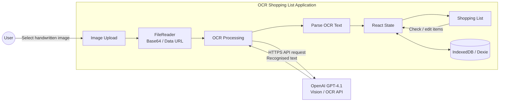

# ocr-shopping-list

A small app I use often.

1. Take a snap of a handwritten shopping list
2. Image is submitted to the OpenAI API with a prompt
3. Returned is OCR-recognised text and a neat checkbox-list of shopping items

## Architecture


## Local Dev
The app lives in the repository root. Install dependencies with `npm ci` there. Then run `npm run test:browser:install` to download Chromium for browser tests. Use the scripts below. The production build is written to `dist/`.

### ENV Variables
When running the `dev` script, use `.env` files to supply required config.

Place a `.env.development` file in the repository root, with the following:
- `VITE_OpenAI_Api_Key`: API Key generated in the OpenAI API Platform.

### Scripts
From the repository root:

```bash
npm run dev        # start Vite
npm run lint       # ESLint
npm run test:run   # unit tests, then headless Chromium tests
npm run test:unit  # unit tests only
npm run test:browser # real browser tests only
npm run build      # TypeScript + Vite production build
npm run preview    # preview production build
```

ESLint also enforces statement spacing in TypeScript files: add a blank line after `if` statements and multiline `const` declarations, and before `return` statements. Put unbraced statement bodies on the next line. Run `npm run lint -- --fix` to apply these spacing fixes automatically.

### Codex instructions and skill
Repository rules live in `AGENTS.md`. Codex discovers the local `pre-commit-checks` skill in `.agents/skills/pre-commit-checks/SKILL.md`; invoke it with `$pre-commit-checks` to run the full local quality gate. These replace the previous Cursor rules.

### Pull requests
New PRs use the template in `.github/PULL_REQUEST_TEMPLATE.md` (Summary, Test plan, and Screenshots). Fill the checklist with the scripts above plus any feature-specific checks. Use `$create-pull-request` to follow the workflow in `.agents/skills/create-pull-request/SKILL.md`.

Screenshots are optional. Include captioned images when requested or useful to explain visual changes; otherwise remove the Screenshots section. Keep API keys and personal information out of captured images. Installing new screenshot tooling requires approval under `AGENTS.md`.

### NGROK
To test over the internet using NGROK, the vite config needs to be updated to allow NGROK's host.

Add the following to `vite.config.ts` (or the active Vite config):

```ts
server: {
	hmr: {
		clientPort: 443,
	},
	allowedHosts: [
		".ngrok-free.app"
	]
},
```

## Saved data

- Dexie saves the current list and image separately in IndexedDB. Checkbox changes do not rewrite the image.
- Images fit within 1 MiB and a 2560-pixel longest edge. The app compresses larger uploads or rejects them.
- OCR uses the original upload while available in memory. After reload, it uses the saved image when you press Process.
- Back keeps the session. Clear deletes it. API keys stay in memory.
- Failed saves keep changes in memory. Keep the page open and use **Retry save**.
- The app deletes old localStorage data without migration. Earlier development schemas need a database reset, which deletes the saved session.

In browser devtools, open Application > IndexedDB > HandyList for saved records, or Application > Local Storage > your site for old keys.

## Tests

Keep tests under `tests/`, browser tests under `tests/browser/`, fixtures under `tests/testFiles/`, and shared setup in `tests/setup.ts`. ESLint enforces test locations.

After `npm ci`, run:

```bash
npm run test:browser:install
npm run test:run
```

`test:run` runs unit tests, then headless Chromium tests. Use `test:unit` or `test:browser` for individual suites, and `npm test` to watch unit tests.

Browser tests check real compression and IndexedDB persistence for all PNG fixtures. They do not call OpenAI or assess handwriting readability.

Playwright 1.61 supports the current Node 18 setup. Repeat the browser install after changing Playwright. Linux CI needs `npm run test:browser:install -- --with-deps`.
