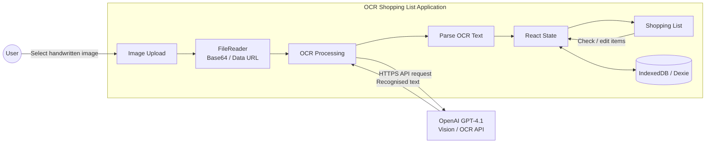

# ocr-shopping-list

A small app I use often.

1. Take a snap of a handwritten shopping list
2. The app sends the image to the OpenAI API with a prompt
3. Returned is OCR-recognised text and a neat checkbox-list of shopping items

## Categories

Select **Categorise** to group items under category headings.
You can change the option when the list is empty or contains items. The app shows only categories that contain items.
Clear **Categorise** to show items in their saved list order. Item names and checked states stay the same.
The control is temporarily disabled while you edit, add an item, or process a photo.

Local keyword rules classify manual items and photo results without extra API requests. Unrecognised items appear under **Other**.
Fruit and vegetables appear under **Fruit & Veg**. Eggs appear under **Pantry**. The app saves the option with the list.
**Soft drinks** includes water, fruit juices, and common soda brands. Brand names also match flavour, diet, and zero-sugar variants.
The brand rules use the [Coca-Cola portfolio](https://www.coca-colacompany.com/brands) and [PepsiCo portfolio](https://www.pepsico.com/brands) as references.
Spirits and wine take priority over mixers. Baking soda and cleaning products keep their product categories.
**Ready Meals** includes pizza, ready meals, and lasagne. Ice appears under **Frozen**. An explicit **frozen** label takes priority over **Ready Meals**.
To extend the rules, edit `src/categories.ts`. Keep specific phrases before general food names.
The rules normalise whitespace and dash separators. They also distinguish phrases such as **baby spinach**, **peanut butter**, and **wine vinegar**.

Select **Edit** to show the six-dot handles. Drag a handle to move one item before or after another item.
Mouse and touch controls use the same handle.
For keyboard control, focus the handle. Press **Arrow Up** or **Arrow Down** to move the item one row.
With **Categorise** selected, moving an item to another group assigns that group's category to the item.
The app saves the order and assigned categories. In edit mode, **Save** keeps moves and **Cancel** restores the previous list.

## Architecture

`src/App.tsx` manages login, the gallery, and page selection.
`src/ListEditor.tsx` manages the selected list. `src/useListDraft.ts` holds draft fields in a reducer.
`src/ListCard.tsx` shows one saved list. `src/storage.ts` manages database operations and schema changes.
Animation helpers remain in `src/listMotion.ts` and `src/navbarMotion.ts`.



## Local Dev
The app lives in the repository root. Install dependencies with `npm ci` there. Then run `npm run test:browser:install` to download Chromium for browser tests. Use the scripts below. The production build writes files to `dist/`.

### ENV Variables
The app does not read API keys from environment variables. Enter your key in the page for photo recognition.
Select **Continue without a key** to test manual lists. **Photo** stays disabled until an API key is active.
The browser sends the entered key directly to OpenAI. The key stays in memory until you sign out or close the page.
The app does not save API keys in IndexedDB or localStorage.

Vite exposes only variables with the `PUBLIC_` prefix. Never use that prefix for secrets.
Existing `.env.development` or `.env.dev` files can remain on your computer. Their old `VITE_OpenAI_Api_Key` values do not enter browser code.
Vite blocks direct requests for `.env` files. Do not change its file restrictions for tunnel testing.

### Scripts
From the repository root:

```bash
npm run dev        # start Vite
npm run lint       # ESLint
npm run test:run   # unit tests, then headless Chromium tests
npm run test:unit  # unit tests only
npm run test:browser # real browser tests only
npm run build      # TypeScript + Vite production build
npm run preview    # preview production build
```

ESLint also enforces statement spacing in TypeScript files: add a blank line after `if` statements and multiline `const` declarations, and before `return` statements. Put unbraced statement bodies on the next line. Run `npm run lint -- --fix` to apply these spacing fixes automatically.

### Codex instructions and skill
Repository rules live in `AGENTS.md`. Codex discovers the local `pre-commit-checks` skill in `.agents/skills/pre-commit-checks/SKILL.md`. Invoke it with `$pre-commit-checks` to run the full local quality gate. These replace the previous Cursor rules.

### Pull requests
New PRs use the template in `.github/PULL_REQUEST_TEMPLATE.md` (Summary, Test plan, and Screenshots). Fill the checklist with the scripts above plus any feature-specific checks. Use `$create-pull-request` to follow the workflow in `.agents/skills/create-pull-request/SKILL.md`.

Screenshots are optional. Include captioned images when requested or useful to explain visual changes. Otherwise omit the Screenshots section. Keep API keys and personal information out of captured images. Installing new screenshot tooling requires approval under `AGENTS.md`.

### NGROK
Use `$phone-test-ngrok` to start phone testing with Codex. Read the [repository skill](.agents/skills/phone-test-ngrok/SKILL.md) for the complete workflow.
The skill checks the public URL and can provide a QR code. Say **done testing** to close its tunnel and stop its test server.

For manual testing, start Vite from the repository root:

```powershell
npm run dev -- --host 127.0.0.1 --port 5173 --strictPort
```

Start ngrok in a second terminal:

```powershell
ngrok http http://127.0.0.1:5173 --host-header=localhost --log=stdout
```

These commands require installed project dependencies and an authenticated ngrok installation.
The host-header option avoids temporary changes to `vite.config.ts`.
Open the HTTPS URL from ngrok with `/ocr-shopping-list/` appended. If ngrok shows a warning page, select **Visit Site**.
After testing, press **Ctrl+C** in the ngrok terminal to close the tunnel. Stop the test server with **Ctrl+C**.

## Multiple lists

After login, the gallery shows each saved list with its name, photo thumbnail, and item count.
Lists without a photo show a placeholder. Select **New list** to create a list.

- The default name uses local time in `dd/mm/yyyy - hh:mm:ss` format. Names can contain up to 256 characters.
- Add items manually or upload one photo. You can upload the first photo later if the saved list has no photo.
  Photo recognition starts immediately and appends items after existing items.
- You can add duplicate items. A list can contain one photo. Use **Clear** before you upload a replacement photo.
- **Save** stores a new list. **Cancel** returns to the gallery without saving the draft.
- Open a saved list to use its checkboxes. Select **Edit** to change its name, items, or order.
- **Save** stores edits. **Cancel** restores the previous values. Checkbox and category changes save automatically.
- **Clear** empties the items and deletes the photo. It keeps the list name and category option. You can then upload another photo.
- **Back** returns to the gallery. **Delete** requires your approval and deletes the list and its photo.

## Saved data

- Dexie saves lists and images separately in IndexedDB. Checkbox changes do not rewrite image bytes.
- Images fit within 1 MiB and a 2560-pixel longest edge. The app compresses larger uploads or rejects them.
- OCR uses the original upload in memory. The app saves only the compressed image.
- Schema version 2 imports a non-empty version 1 session as **Imported list**. Its photo, order, categories, and checkboxes remain available.
- Failed saves keep the draft in memory and show the error reason. Keep the page open and retry saving.
- An open list returns to the gallery if another tab deletes it. A stale save cannot recreate a deleted list.
- Lists stay in this browser on this site. They do not sync between devices or different tunnel domains.

In browser devtools, open Application > IndexedDB > HandyList. The `lists` table stores list records. The `images` table stores photos.
The `sessions` table remains for the version 1 migration. New lists use the `lists` table.

## Tests

Keep tests under `tests/`, browser tests under `tests/browser/`, fixtures under `tests/testFiles/`, and shared setup in `tests/setup.ts`. ESLint enforces test locations.

After `npm ci`, run:

```bash
npm run test:browser:install
npm run test:run
```

`test:run` runs unit tests, then headless Chromium tests. Use `test:unit` or `test:browser` for individual suites, and `npm test` to watch unit tests.

Browser tests check real compression and IndexedDB persistence for all PNG fixtures.
They also check schema migration, separate lists, photo deletion, transaction rollback, and stale saves.
Layout checks cover 375, 991, 992, and 1280 pixels in light and dark modes.
The delete modal test loads Bootstrap in the app's stylesheet order and checks the modal outside the app root.
`vitest.browser.config.ts` prepares React and React Bootstrap before the tests to prevent dependency reloads during a test. They do not call OpenAI or assess handwriting readability.

Playwright 1.61 supports the current Node 18 setup. Repeat the browser install after changing Playwright. Linux CI needs `npm run test:browser:install -- --with-deps`.

### Category properties

Run the generated category checks with:

```bash
npm run test:unit -- tests/categories.property.test.ts
```

The suite uses deterministic generators with Vitest. It requires no additional packages.
The independent item set is in `tests/fixtures/categoryItems.ts`. Add expected categories there when you extend item coverage.
The generators vary case, quantities, suffixes, whitespace, and dash separators. Compound products check conflicts between product names and ingredient names.
Additional checks test word boundaries and 2,000 arbitrary strings with the fixed seed `0x3ca7e`.
Failures show the generated input. Each item starts with its simplest variant. The suite does not shrink failures automatically.
