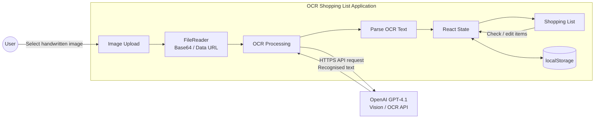

# ocr-shopping-list

A small app I use often.

1. Take a snap of a handwritten shopping list
2. Image is submitted to the OpenAI API with a prompt
3. Returned is OCR-recognised text and a neat checkbox-list of shopping items

## Architecture


## Local Dev
### ENV Variables
When running the `dev` script, use `.env` files to supply required config.

Place a `.env.development` file in the `/ocr-shopping-list-vite` directory, with the following:
- `VITE_OpenAI_Api_Key`: API Key generated in the OpenAI API Platform.

### NGROK
To test over the internet using NGROK, the vite config needs to be updated to allow NGROK's host.

Add the following to `vite.config.js`:

```js
server: {
	hmr: {
		clientPort: 443,
	},
	allowedHosts: [
		".ngrok-free.app"
	]
},
```

