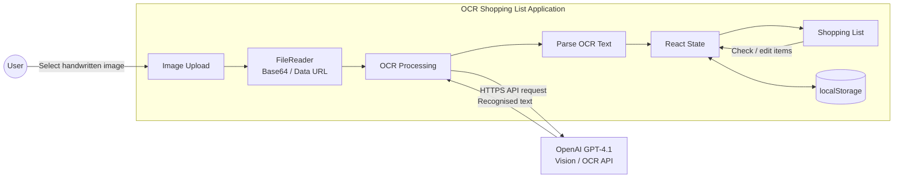

# ocr-shopping-list

A small app I use often.

1. Take a snap of a handwritten shopping list
2. Image is submitted to the OpenAI API with a prompt
3. Returned is OCR-recognised text and a neat checkbox-list of shopping items

## Architecture


## Local Dev
The app lives in the repository root. Install dependencies with `npm ci` there, then use the scripts below. The production build is written to `dist/`.

### ENV Variables
When running the `dev` script, use `.env` files to supply required config.

Place a `.env.development` file in the repository root, with the following:
- `VITE_OpenAI_Api_Key`: API Key generated in the OpenAI API Platform.

### Scripts
From the repository root:

```bash
npm run dev        # start Vite
npm run lint       # ESLint
npm run test:run   # Vitest (single run)
npm run build      # TypeScript + Vite production build
npm run preview    # preview production build
```

### Codex instructions and skill
Repository rules live in `AGENTS.md`. Codex discovers the local `pre-commit-checks` skill in `.agents/skills/pre-commit-checks/SKILL.md`; invoke it with `$pre-commit-checks` to run the full local quality gate. These replace the previous Cursor rules.

### Pull requests
New PRs use the template in `.github/PULL_REQUEST_TEMPLATE.md` (Summary, Test plan, and Screenshots). Fill the checklist with the scripts above plus any feature-specific checks. Use `$create-pull-request` to follow the workflow in `.agents/skills/create-pull-request/SKILL.md`.

For each PR, run the app with `npm run dev` from the repository root and capture the affected UI areas using available browser automation or screenshot tooling. Vite loads the OpenAI API key from the env file described above; keep its value out of screenshots and PR content. Capture the final behavior, including desktop/mobile views for layout changes, inspect the images, and embed them in the PR with captions. For changes with no visible UI impact, explain that in Screenshots; if capture is blocked, document the blocker. Installing new screenshot tooling requires approval under `AGENTS.md`.

### NGROK
To test over the internet using NGROK, the vite config needs to be updated to allow NGROK's host.

Add the following to `vite.config.ts` (or the active Vite config):

```ts
server: {
	hmr: {
		clientPort: 443,
	},
	allowedHosts: [
		".ngrok-free.app"
	]
},
```
